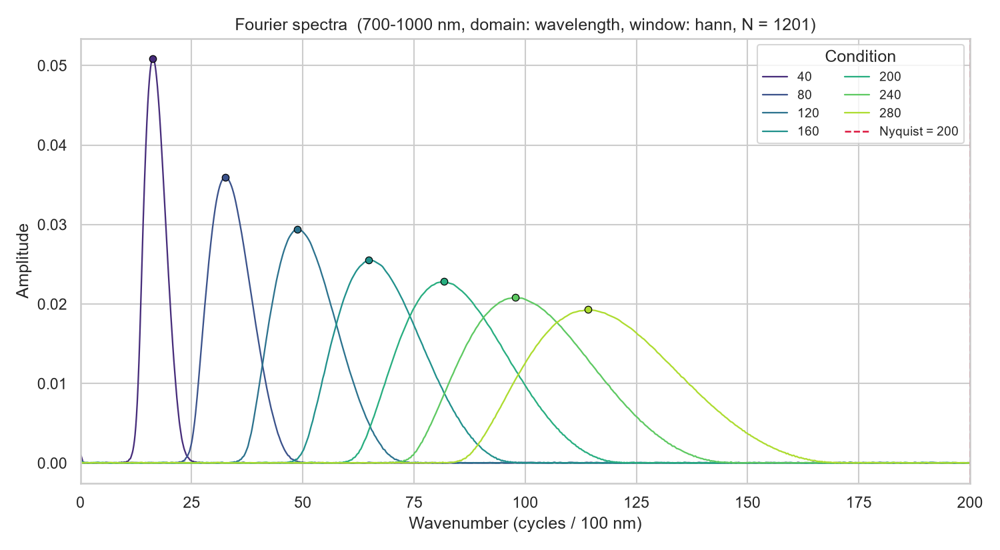
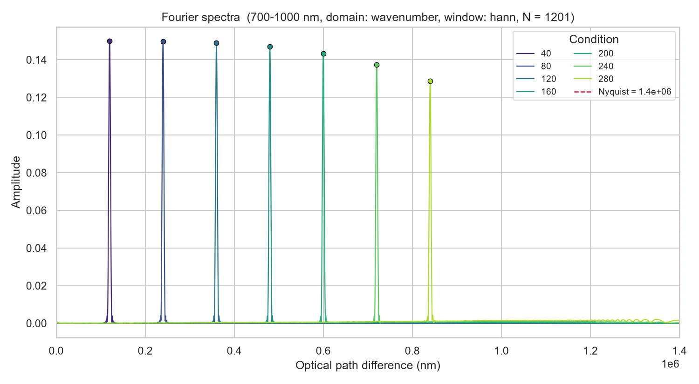
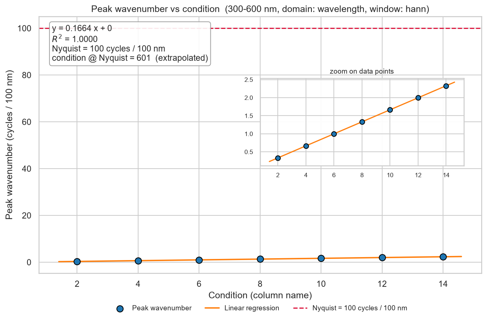
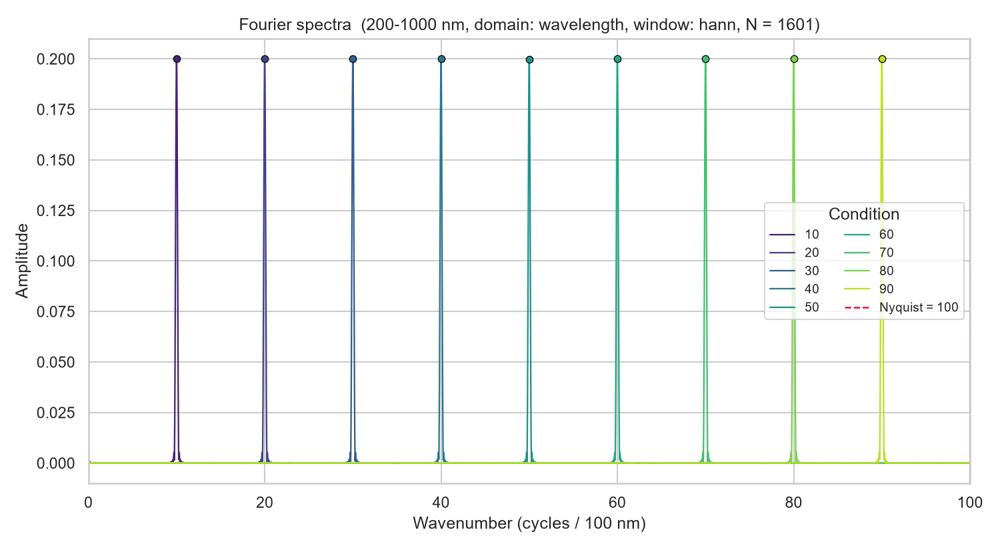
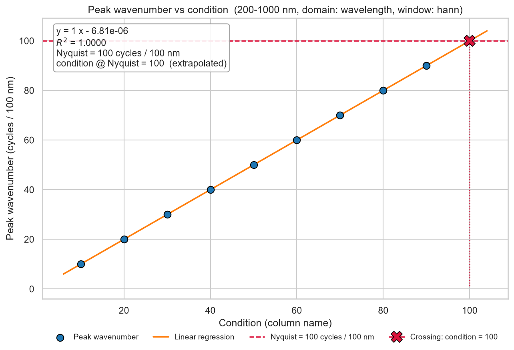
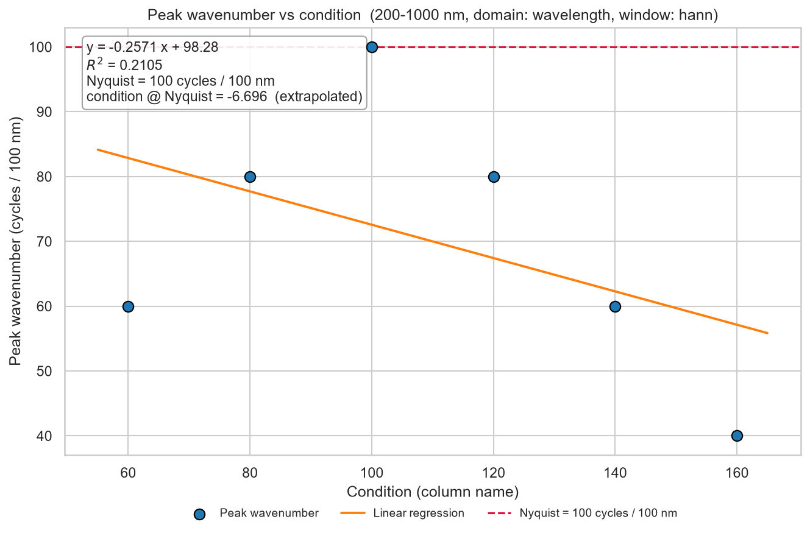
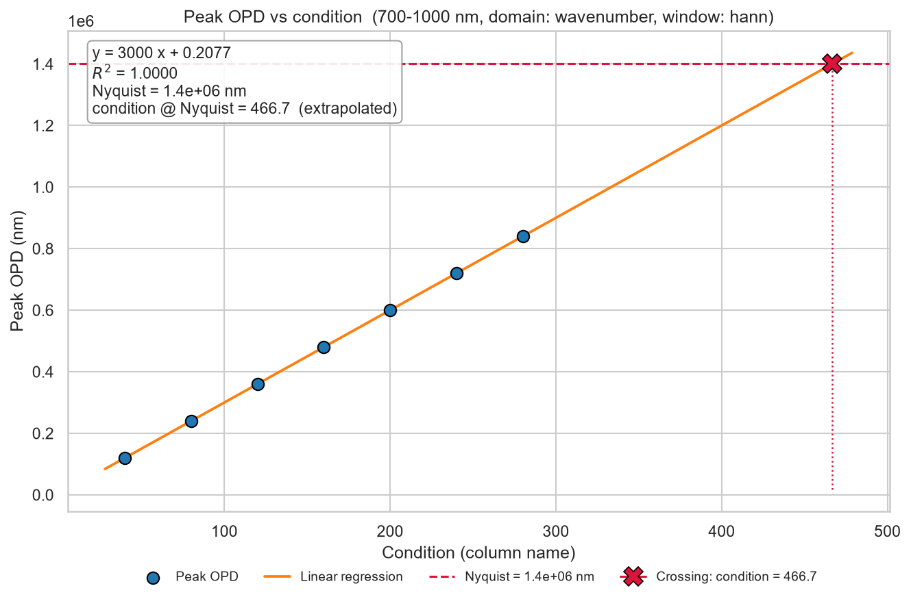

# 干渉スペクトル解析ツール 解説

このドキュメントは [ir_ft_analysis.py](ir_ft_analysis.py) が何をしているかを、
フーリエ変換にあまり馴染みのない人でも読み進められるように説明したものです。

**このドキュメントはソースコードと対で管理します。**
ir_ft_analysis.py / make_testdata.py / test_ir_ft_analysis.py を更新したら、
このドキュメントの該当箇所も必ず更新してください。

| ファイル | 役割 |
|---|---|
| [ir_ft_analysis.py](ir_ft_analysis.py) | 解析ツール本体 |
| [make_testdata.py](make_testdata.py) | 検証用の仮想データ生成 |
| [test_ir_ft_analysis.py](test_ir_ft_analysis.py) | 自己テスト（真値と照合） |
| [README.md](README.md) | 使い方の早見表 |
| CODE_GUIDE.md | このドキュメント |

---

## 1. このツールは何をするのか

薄い膜や平行平板に光を当てると、表面で反射した光と裏面で反射した光が干渉して、
反射スペクトルに**波打つ模様（干渉縞）**が現れます。この波打ちの**細かさ**は
膜の厚さで決まります。厚い膜ほど縞が細かくなります。

このツールは、その波打ちが**どれくらい細かいか**をフーリエ変換で数値化します。
処理はおおまかに 3 段階です。

1. スペクトルをフーリエ変換して、縞の細かさごとの強さ（フーリエスペクトル）を出す
2. 一番強い縞の細かさ（**振幅最大のピーク**）を条件ごとに記録する
3. 条件とピーク位置の関係を直線でフィットし、**測定限界に達する条件**を求める

---

## 2. まず動かしてみる

```bash
python ir_ft_analysis.py --band 300-600 --window hann
```

引数なしで実行すると、波長帯域や窓関数を対話的に聞いてくれます。

```bash
python ir_ft_analysis.py
```

検証用データを作り直したいときは次を実行します。

```bash
python make_testdata.py
```

コードを変更したあとは、必ず自己テストを通してください。

```bash
python test_ir_ft_analysis.py
```

---

## 3. フーリエ変換の基礎

### 3.1 フーリエ変換は何をしてくれるのか

フーリエ変換は、**波形を、いろいろな細かさの波の足し合わせに分解する**操作です。
出力は**どの細かさの波が、どれくらいの強さで入っているか**の一覧になります。

音声の解析なら、横軸は 1 秒あたりの振動回数、つまり周波数 [Hz] です。
今回の入力は時間ではなく**波長**なので、横軸は 1 nm あたりの波の数、
つまり**波長 1 nm の中に干渉縞が何周期入るか**になります。

### 3.2 なぜ単位が 波数/100nm なのか

1 nm あたりの波の数だと 0.01 のような小さい値ばかりになって読みにくいので、
100 倍して**100 nm あたりの波の数**にしています。これがこのツールの横軸の単位、
**波数/100nm** です。

```
波数 [/100nm] = FFT が返す周波数 [/nm] × 100
```

たとえば波数が 2.0 /100nm なら、100 nm 進むあいだに干渉縞が 2 山あるという意味です。

該当するコードは `fourier_transform()` の中の `freq * unit_scale` の部分です。

### 3.3 ナイキスト限界とは

デジタルのデータは飛び飛びの点でしかスペクトルを測っていません。
**1 周期あたり最低 2 点なければ、波の形は再現できません。**
これが**ナイキスト限界**で、測れる縞の細かさの上限です。

データの波長間隔 Δλ から次のように決まります。

```
ナイキスト限界 [/100nm] = 100 / (2 × Δλ)
```

付属データは Δλ = 0.5 nm なので、上限は **100 波数/100nm** です。
これは 1 nm に 1 山、つまり 2 点で 1 周期という限界そのものです。

限界を超えた細かい縞を測ると、**実際より粗い縞として誤って観測されます。**
これを**エイリアシング（折り返し）**と呼びます。折り返し後の見かけの波数は
`2 × ナイキスト限界 − 真の波数` になります。第 7 章で実例を示します。

### 3.4 波数分解能

**どれだけ近い 2 つの縞を別物として区別できるか**が波数分解能です。
解析に使ったデータ点数 N と間隔 Δλ から決まります。

```
波数分解能 [/100nm] = 100 / (N × Δλ)
```

分母は解析帯域の幅そのものなので、**帯域を広く取るほど分解能は細かくなります。**
300–600 nm（601 点、Δλ = 0.5 nm）なら 0.333 /100nm です。

ここで大事なのは、**ナイキスト限界は測れる細かさの上限、分解能は見分けられる差**
という違いです。混同しやすいので注意してください。

---

## 4. 波長で変換するか、波数で変換するか

ここがこのツールで最も重要な選択です。`--domain` で切り替えます。

### 4.1 干渉縞は本来 1/λ に対して等間隔

厚さ d、屈折率 n の平行平板による干渉の位相は、次の式で決まります。

```
位相 = 2π × (2nd) / λ = 2π × OPD × (1/λ)      OPD = 2nd（光路差）
```

位相は 1/λ に**比例**しています。つまり干渉縞は、波長 λ に対してではなく、
**波数 1/λ に対して等間隔**に並びます。

波長を横軸に取ると、青い側では縞が詰まり、赤い側では広がります。
広い帯域をまとめて波長軸で変換すると、**1 つの膜なのにピークが広がってしまう**
のはこのためです。

### 4.2 両者の違いを実際に見る

膜厚 40〜280 µm の平行平板データ（`dataset_film.csv`）を、
同じ帯域 700–1000 nm で両方のやり方で変換した結果です。

波長 λ に対する FFT：



波数 1/λ に対する FFT：



同じデータとは思えないほど違います。波数ドメインでは**ピークが針のように鋭く**、
振幅も真値の 0.15 をほぼ復元しています。波長ドメインではピークが大きく広がり、
振幅は 0.02〜0.05 まで下がってしまっています。

### 4.3 波数ドメインの出力は光路差そのもの

独立変数が 1/λ [1/nm] のとき、フーリエ変換の共役軸の単位は**長さ [nm]** になります。
そしてその位置は**光路差 OPD = 2nd** そのものです。つまり、

- ピーク位置を読むだけで光路差がわかる
- 屈折率 n がわかっていれば膜厚 d = OPD / (2n) が直接求まる

`--refractive-index 1.5` を付けると、膜厚の推定値が出力に追加されます。

実際の検証結果（膜厚 40 µm の列）:

| 項目 | 真値 | 解析結果 |
|---|---|---|
| 光路差 OPD | 120000 nm | 120000 nm |
| 膜厚 d | 40000 nm | 40000 nm |

### 4.4 1/λ グリッドへの並べ直しが必要な理由

波長が等間隔なら、1/λ は**等間隔になりません**。フーリエ変換は等間隔データを
前提とするので、`build_analysis_grid()` で 1/λ が等間隔になるよう並べ直しています。

このとき使う補間の質が効いてきます。単純な線形補間は、**1 周期あたりの点数が
少ない細かい縞の振幅を削ってしまいます。** そこで既定では 3 次エルミート補間
（`--interp cubic`）を使っています。

膜厚 280 µm の列（ナイキスト限界の 60 % に相当）での振幅：

| 補間 | 振幅（真値 0.15） | ピーク位置 |
|---|---|---|
| linear | 0.106 | 正確 |
| cubic | 0.129 | 正確 |

**ピーク位置はどちらでも正確ですが、振幅は cubic の方が保たれます。**
なお細かい縞ほど振幅が落ちる傾向は残るので、振幅を厳密に議論したい場合は
波長のサンプリング間隔をもっと細かくしてください。

### 4.5 どちらを使うべきか

| 目的 | 推奨 |
|---|---|
| 膜厚や光路差を求めたい | **波数ドメイン** |
| 広い帯域をまとめて解析したい | **波数ドメイン** |
| 波長ごとの縞の細かさそのものを見たい | 波長ドメイン |
| 狭い帯域だけ見る | どちらでもほぼ同じ |

`--domain both` を付ければ両方を一度に出力できます。

---

## 5. 処理の流れ

`run_band()` が 1 帯域・1 ドメイン分の処理をまとめています。中身は次の順です。

### ステップ 1: CSV を読む（`load_spectra`）

- A 列を波長、B 列以降を各条件の反射率として読み込みます
- 列名が数値でない列、値が空の列は自動的に除外します
- 列の途中の欠測は補間で埋めます
- 波長が等間隔でなければ、等間隔に並べ直します

### ステップ 2: 帯域を切り出しグリッドを作る（`build_analysis_grid`）

指定された波長帯域だけを取り出します。波数ドメインなら、ここで 1/λ が
等間隔になるよう並べ直します（4.4 節）。

### ステップ 3: トレンドを除く（`detrend_signal`）

反射率は 0.5 前後の**下駄**を履いています。この一定成分をそのまま変換すると、
**周波数ゼロの位置に巨大なピークが立って、肝心の干渉縞が埋もれます。**

既定の `linear` は、一定成分と緩やかな傾きの両方を取り除きます。
ピーク探索でも周波数ゼロの点は最初から除外しています。

### ステップ 4: 窓関数を掛ける（`make_window`）

フーリエ変換は、**切り出したデータが延々と繰り返している**と仮定して計算します。
切り出した両端が滑らかにつながらないと、そこが不連続な段差とみなされ、
本来ないはずの成分が広い範囲ににじみ出ます。これを**スペクトル漏れ**と呼びます。

窓関数はデータの**両端をなめらかに 0 へ絞る**重みで、この漏れを抑えます。

| 窓関数 | 性格 |
|---|---|
| `rectangular` | 何もしない。分解能は最良だが漏れが最大 |
| `hann` | 標準的な選択。既定値 |
| `blackman` / `nuttall` / `blackmanharris` | 漏れが小さい。ピークは太くなる |
| `flattop` | 振幅を最も正確に読める。位置の精度は落ちる |
| `kaiser` | β で漏れと分解能のバランスを調整できる |

**弱いピークが強いピークの裾に埋もれているときは漏れの少ない窓、
近接した 2 つのピークを分けたいときは漏れの大きい窓が有利**という関係にあります。

### ステップ 5: フーリエ変換と振幅の正規化（`fourier_transform`）

実データなので `np.fft.rfft` を使い、正の周波数側だけを計算します。
振幅は次のように正規化しています。

```
振幅 = 2 × |FFT の値| / （窓関数の係数の合計）
```

- 窓を掛けると信号全体が小さくなるので、**窓の係数の合計で割って元に戻します**
- 実データのエネルギーは正と負の周波数に半分ずつ分かれるので、**2 倍します**
- ただし周波数ゼロとナイキスト限界の点だけは対になる相手がいないので 2 倍しません

この正規化のおかげで、**振幅の値は元の干渉縞の振れ幅とそのまま一致します。**
振幅 0.2 の正弦波を入れれば、ピークの高さも 0.2 になります。

### ステップ 6: ピークを探す（`analyze_band`, `parabolic_peak`）

周波数ゼロを除いて振幅が最大の点を探します。精度を上げるオプションが 2 つあります。

- `--zero-pad N`: データの後ろに 0 を付け足して変換します。**分解能そのものは
  上がりませんが、曲線が細かく描かれるのでピーク位置を読み取りやすくなります**
- `--refine-peak`: ピークの前後 3 点に放物線を当てはめ、点と点の**あいだ**にある
  真のピーク位置を推定します

この 2 つを併用すると、ピーク位置の誤差は分解能の 1 % 未満まで下がります。

### ステップ 7: 線形回帰とナイキスト到達条件（`fit_regression`）

条件（列名の数値）を x、ピーク位置を y として scikit-learn で直線を当てはめます。
そのうえで、**この直線がナイキスト限界に届く条件**を求めます。

```
ナイキスト到達条件 = (ナイキスト限界 − 切片) / 傾き
```

これは、**あとどれくらい条件を進めると測定限界に達するか**を表します。
測定した条件の範囲外なら外挿である旨を図と出力に明記します。

### ステップ 8: 出力

図 3 枚と表 2 枚、サマリ 1 枚を出力します。詳細は第 6 章を参照してください。

---

## 6. 出力ファイルの読み方

ファイル名は `band_<下限>-<上限>nm_<ドメイン>_...` の形式です。
ドメイン部分は波長なら `lambda`、波数なら `sigma` になります。

| ファイル | 内容 |
|---|---|
| `*_fourier_spectrum.png` | フーリエスペクトル。横軸が縞の細かさ、縦軸が振幅。丸印が各列の最大ピーク |
| `*_peak_regression.png` | 条件とピーク位置の散布図、回帰直線、決定係数、ナイキスト限界の破線、交点 |
| `*_raw_spectra.png` | 変換に投入した信号そのもの。データがおかしいときはまずこれを見る |
| `*_peaks.csv` | 列ごとのピーク位置・振幅・ナイキスト比・限界近接フラグ |
| `*_fourier_spectrum.csv` | フーリエスペクトルの数値そのもの |
| `*_summary.json` | 解析条件、ナイキスト限界、回帰係数、決定係数、到達条件 |

`*_peaks.csv` の `near_nyquist` 列が `True` の行には注意してください。
**ナイキスト限界の直下では振幅が最大 2 倍まで過大評価され、さらにその成分が
限界を超えて折り返してきたものである可能性もあります。**

散布図はナイキスト限界の破線まで縦軸を取るため、実測点が下に潰れがちです。
その場合は自動で拡大図を重ねて表示します。



---

## 7. テストデータと検証結果

`make_testdata.py` が 3 種類の検証用データを生成します。
それぞれ真値を記した `*_truth.csv` が付属します。

### 7.1 highfreq: 高周波側の検証

条件の値がそのまま波数 [/100nm] になるデータです。条件 10 から 90 まで、
**ナイキスト限界 100 の 10 % から 90 % までを覆っています。**



限界の 90 % に当たる条件 90 でもピークは鋭いままで、結果は次のとおりです。

| 項目 | 真値 | 解析結果 |
|---|---|---|
| ピーク位置 | 条件と同じ値 | 誤差 0.02 /100nm 未満 |
| 振幅 | 0.2 | 誤差 0.03 % 未満 |
| 回帰直線 | y = 1.0 x | y = 1 x − 6.8e−06 |
| 決定係数 | 1.0 | 1.00000000 |
| ナイキスト到達条件 | 100 | 100.00000 |



### 7.2 alias: 限界を超えたときの挙動

真の波数がナイキスト限界を超える列を含むデータです。

| 条件（真の波数） | 予想される観測波数 | 解析結果 |
|---|---|---|
| 60 | 60 | 60.00 |
| 80 | 80 | 80.00 |
| 100 | 100 | 99.98 |
| 120 | **80** | 80.00 |
| 140 | **60** | 60.00 |
| 160 | **40** | 40.00 |

限界を超えた条件では、**波数が増えているのに観測値は減っていきます。**
その結果、決定係数は 0.21 まで崩れ、ナイキスト到達条件も負の値という
明らかにおかしな数字になります。



**決定係数が急に悪化したら、まずエイリアシングを疑ってください。**
対策は波長のサンプリング間隔を細かくすることです。

### 7.3 film: 薄膜干渉モデル

屈折率 1.5、膜厚 40〜280 µm の平行平板の干渉を再現したデータです。
位相が 1/λ に比例するため、波数ドメインの検証に使います。

| 項目 | 真値 | 解析結果 |
|---|---|---|
| 光路差 OPD | 3000 × 膜厚[µm] nm | 相対誤差 0.0002 % 未満 |
| 膜厚推定 | 条件そのもの | 絶対誤差 0.4 nm 未満 |
| 回帰直線の傾き | 3000 nm/µm | 2999.995 |
| 決定係数 | 1.0 | 1.00000000 |
| ナイキスト到達条件 | 466.67 µm | 466.667 µm |



### 7.4 自己テスト

`test_ir_ft_analysis.py` は上記を含む 45 項目を自動で検証します。
全窓関数の復元精度、補間方式の比較、振幅正規化の理論値との一致、
不等間隔データや欠測への耐性、引数パーサまで確認します。

```bash
python test_ir_ft_analysis.py
```

---

## 8. よくあるつまずき

### ピークが波数ゼロ付近に出る

反射率の下駄（一定成分）が残っています。`--detrend linear` が既定で有効ですが、
`none` にしていないか確認してください。ベースラインが強く曲がっている場合は、
解析帯域を狭めるのが有効です。

### 条件ごとのピークが分離しない

分解能が足りていません。**分解能は解析帯域の幅で決まります。**
帯域を広げてください。窓関数を `rectangular` や `hann` に変えるのも有効です
（`blackman` 系や `flattop` はピークが太くなります）。

### 振幅が想定より小さい

考えられる原因は 3 つあります。

1. 解析帯域に干渉縞が 1〜2 周期しか入っていない（窓関数で削られる）
2. 波数ドメインで、縞が細かすぎて補間で振幅が落ちている（4.4 節）
3. 波長ドメインで、帯域内の縞の細かさが変化してピークが広がっている（4.2 節）

### 決定係数が急に悪い

エイリアシングの可能性が高いです。7.2 節を参照してください。
`near_nyquist` 列が `True` になっている行がないかも確認してください。

### ナイキスト到達条件が負になる、または極端に大きい

回帰直線の傾きがほぼ 0 か、負になっています。
条件とピーク位置に本当に直線関係があるか、散布図で確認してください。

---

## 9. コードの地図

| 関数 | 役割 |
|---|---|
| `load_spectra` | CSV を読み、等間隔の波長グリッドに整える |
| `select_band` | 指定した波長帯域を切り出す |
| `interpolate` | 線形または 3 次エルミート補間（グリッド並べ直し用） |
| `build_analysis_grid` | ドメインに応じた等間隔グリッドと信号を作る |
| `detrend_signal` | 一定成分と傾きを取り除く |
| `make_window` | 窓関数の係数を作る |
| `fourier_transform` | FFT を実行し、共役軸と正規化済み振幅を返す |
| `parabolic_peak` | 放物線近似でピーク位置をサブビン精度に補正する |
| `analyze_band` | 1 帯域・1 ドメインの全列を解析する中心の関数 |
| `fit_regression` | 線形回帰とナイキスト到達条件の算出 |
| `is_near_nyquist` | ピークが限界に近すぎないか判定する |
| `auto_xmax` | フーリエスペクトル図の横軸上限を自動で決める |
| `plot_fourier_spectra` / `plot_peak_scatter` / `plot_raw_spectra` | 作図 |
| `peaks_dataframe` / `spectra_dataframe` / `summary_dict` | 出力の整形 |
| `run_band` | 解析から保存・作図までを一括実行 |
| `main` | 引数解析と全体の制御 |

データを運ぶ入れ物は 4 つです。

| クラス | 中身 |
|---|---|
| `DomainInfo` | 変換の独立変数と、共役軸の単位・ラベル・列名の定義 |
| `SpectrumData` | CSV から読んだ波長・反射率・条件値 |
| `ColumnFFTResult` | 1 列分のフーリエスペクトルとピーク情報 |
| `BandAnalysis` | 1 帯域・1 ドメインの解析条件と全列の結果 |

---

## 10. 更新履歴

| 日付 | 内容 |
|---|---|
| 2026-08-18 | 初版。波長ドメイン FFT、窓関数選択、帯域選択、線形回帰、ナイキスト到達条件 |
| 2026-08-18 | 波数 1/λ ドメインの FFT を追加。3 次エルミート補間、限界近接の警告、膜厚推定を追加 |
| 2026-08-18 | 高周波・エイリアシング・薄膜の検証用データ生成と自己テストを追加 |
